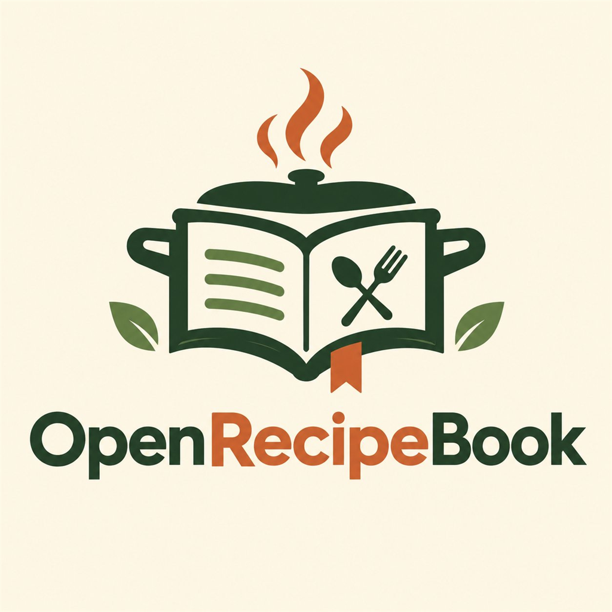

<p align="center">
  
</p>

# OpenRecipeBook

OpenRecipeBook is a free, open-source personal cookbook application for Windows PC and Android. It provides a local-first recipe keeper modeled on commercial cookbook apps, without subscriptions, accounts, or paywalls.

## Install and Download

OpenRecipeBook runs strictly as a native desktop or mobile app with local file storage:

| Platform | Download / Link | Notes |
|---|---|---|
| **Windows PC (.exe)** | [Download Windows Executable](https://github.com/DontKwo/OpenRecipeBook/releases/latest/download/OpenRecipeBook-Windows.exe) | Standalone Windows executable storing recipes directly on disk (`Documents\OpenRecipeBook\recipes`) with unconstrained HTTP recipe URL importing. |
| **Android (.apk)** | [Download Android APK](https://github.com/DontKwo/OpenRecipeBook/releases/latest/download/OpenRecipeBook-Android.apk) | Standalone native Android application (.apk). Direct install with local file storage (`Android/data/org.openrecipebook.app/files/recipes`), file picking, and native URL import. |

### Platform Details

- **Windows Desktop:** Download and run `OpenRecipeBook-Windows.exe`. Recipes are stored directly as `.recipe.json` files inside your chosen recipe storage folder (`Documents\OpenRecipeBook\recipes` by default), independent of browser cookies or cache. Unsigned releases may show a standard Windows SmartScreen prompt on first run; click "More info" then "Run anyway".
- **Android App:** Download the `.apk` file directly to your Android device and tap to install. Operates fully offline, uses native file and photo picking, stores recipe files in your app storage folder, and allows sharing recipe links from your browser straight into OpenRecipeBook.
- **Bridging Devices:** Copy `.recipe.json` files directly from your storage folder or use the built-in full backup export (`.openrecipebook.zip`) to transfer recipes between Windows Desktop and Android.

## Key Features

- **Direct On-Disk Recipe Storage:** View your recipe storage folder path, open the folder, see every `.recipe.json` or backup file inside it, and add recipe files on both Windows Desktop and Android.
- **Folder Organization:** Create recipe folders, open any folder directly, and search or select recipes to add into it.
- **Instant Scaling Engine:** Fast multipliers (0.5x, 1x, 2x, 3x, and custom) for ingredient quantities with fraction formatting, unit promotion (3 tsp -> 1 tbsp), and yield stepping.
- **Ingredient Totals Tool:** Pick multiple recipes to compute combined ingredient requirements with exact rational arithmetic (e.g. 1 cup + 2/3 cup + 1/3 cup flour sums to 2 cups flour).
- **Meal Planner:** Weekly calendar planner with Breakfast, Lunch, Dinner, and Snack slots. Add meals to your shopping list with a single click.
- **Aisle-Grouped Shopping List:** Organize ingredients automatically by grocery aisle, tick off items in the store, and copy formatted lists to your clipboard.
- **Interactive Cook Mode:** Full-screen step-by-step reading view with screen wake lock and one-tap concurrent cooking timers.
- **Universal Importer:** Import from Recipe Keeper zip archives, Paprika exports, schema.org JSON-LD, plain text, and web pages.

## Development Setup

Prerequisites: Node.js 18+ and npm.

```bash
# Install dependencies
npm install

# Run Vitest unit test suite
npm test

# Build application assets
npm run build

# Build standalone Windows desktop executable (build/OpenRecipeBook.exe)
npm run build:desktop
```

## Documentation

- [DESIGN.md](DESIGN.md): Full architectural specification, requirements, and design notes.
- [PROGRESS.md](PROGRESS.md): Live implementation tracker, handoff state, and technical notes.
- [DECISIONS.md](DECISIONS.md): Architectural decision records.
- [THIRD_PARTY_LICENSES.md](THIRD_PARTY_LICENSES.md): Third-party open source licenses and USDA FoodData Central data citations.

## License

OpenRecipeBook is open-source software licensed under the [MIT License](LICENSE).
