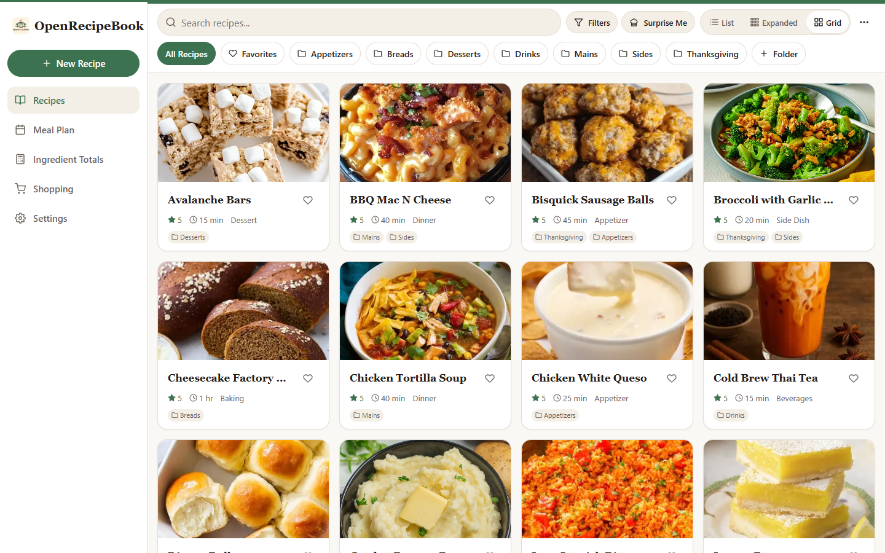

  

# OpenRecipeBook

**Save recipes locally, scale ingredients cleanly, plan weekly meals, and shop offline without accounts or subscriptions.**

OpenRecipeBook is a free personal cookbook app for Windows, macOS, Linux, and Android. Every recipe stays on your own hardware as plain `.recipe.json` files alongside one-click backups.

---

## Download

| Platform | Download | Setup Guide |
| :--- | :--- | :--- |
| Windows | [OpenRecipeBook-Windows.exe](https://github.com/DontKwo/OpenRecipeBook/releases/latest/download/OpenRecipeBook-Windows.exe) | [Windows Install Steps](docs/INSTALLATION.md#windows) |
| macOS | [OpenRecipeBook-macOS.zip](https://github.com/DontKwo/OpenRecipeBook/releases/latest/download/OpenRecipeBook-macOS.zip) | [macOS Install Steps](docs/INSTALLATION.md#macos) |
| Linux | [OpenRecipeBook-Linux.tar.gz](https://github.com/DontKwo/OpenRecipeBook/releases/latest/download/OpenRecipeBook-Linux.tar.gz) | [Linux Install Steps](docs/INSTALLATION.md#linux) |
| Android | [OpenRecipeBook-Android.apk](https://github.com/DontKwo/OpenRecipeBook/releases/latest/download/OpenRecipeBook-Android.apk) | [Android APK Install Guide](docs/APK_INSTALLATION.md) |

---

## Screenshots

  

---

## How to Use

1. Download OpenRecipeBook for your computer or Android device from the table above.
2. Follow the [Desktop Installation Guide](docs/INSTALLATION.md) or [Android APK Installation Guide](docs/APK_INSTALLATION.md) if your device displays an unrecognized-app prompt.
3. Add recipes manually, import web links or Recipe Keeper/Paprika exports, and arrange folders.
4. Drag meals onto your weekly planner, sum ingredients in **Ingredient Totals**, or launch **Cook Mode**.

---

## Key Features

- **On-Disk Recipe Files**: Stores recipes directly as portable `.recipe.json` files on your device without browser storage lock-in.
- **Instant Scaling & Totals**: Multiply servings with exact kitchen fractions and sum mixed units across recipes.
- **Meal Planner & Shopping List**: Plan weekly menus and sort shopping ingredients automatically by grocery aisle.

---

## Safety & Disclaimers

- **Official `main` Releases Only**: Download executables and APKs exclusively from [DontKwo/OpenRecipeBook Releases](https://github.com/DontKwo/OpenRecipeBook/releases/latest) (`main` branch). Never run forked builds unless you are sure they contain no malware; only official `main` releases are maintained by the author, and I make no promises.
- **OS & Phone Security Warnings**: Windows SmartScreen, macOS Gatekeeper, and Android Play Protect will likely warn that independently signed apps or APK files are unrecognized or unsafe. Bypassing these warnings is strictly at your own discretion using [Desktop Installation Guide](docs/INSTALLATION.md) or [Android APK Installation Guide](docs/APK_INSTALLATION.md).
- **Local File Modifications & AS-IS Warranty**: OpenRecipeBook writes recipe and backup files into folders you select. Provided "AS IS" under the [MIT License](LICENSE) with zero warranty or liability; you use this software entirely at your own risk.

---

## Documentation

### User Documentation
- [User Guide](docs/USER_GUIDE.md)
- [Desktop Installation Guide](docs/INSTALLATION.md)
- [Android APK Installation Guide](docs/APK_INSTALLATION.md)
- [Frequently Asked Questions](docs/FAQ.md)

### Developer Documentation
- [Developer Guide](docs/DEVELOPMENT.md)
- [Developer uv Installation](docs/UV_INSTALLATION.md)
- [Packaging Guide](docs/PACKAGING.md)

### AI, Technical & Reference Documentation
- [System Architecture](docs/ARCHITECTURE.md)
- [File Format Specification](docs/FILE_FORMAT.md)
- [AI Agent Reference](AGENTS.md)

### Legal & Security Policies
- [Security Policy](SECURITY.md)
- [Third-Party Notices](THIRD_PARTY_NOTICES.md)
- [MIT License](LICENSE)
